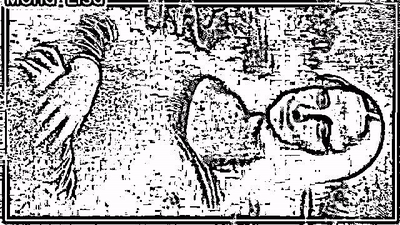
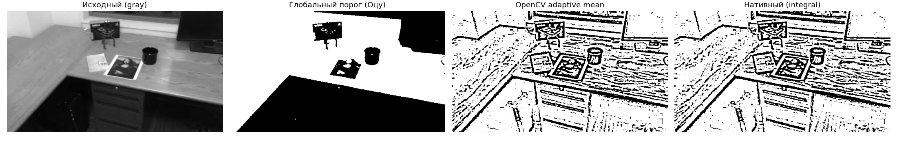
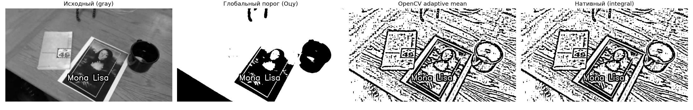
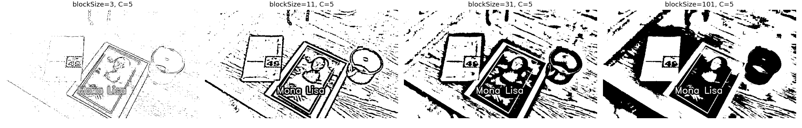
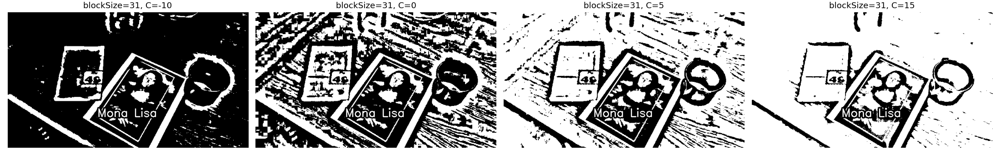
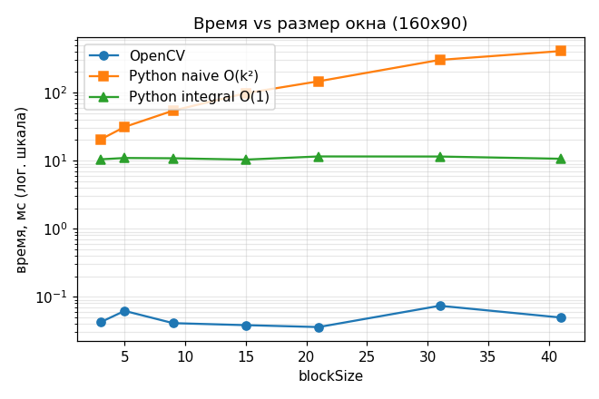
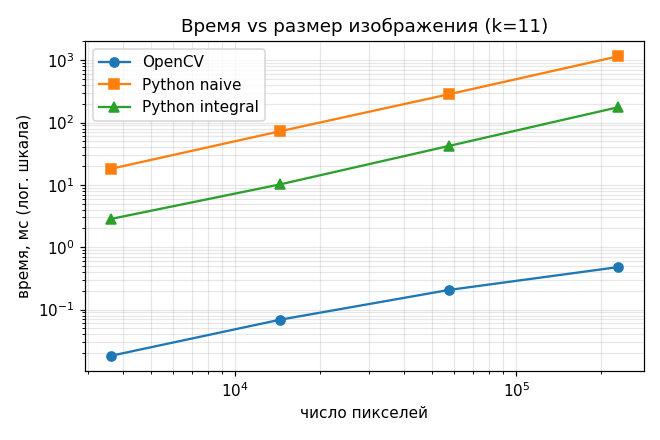

ЛР1. Бинаризация с адаптивным порогом (вариант 2, метод mean)

Цель работы: научиться реализовывать простой алгоритм обработки изображений, реализовать его двумя способами (встроенная функция библиотеки и «нативный» код на Python) и сравнить быстродействие.

1. Теоретическая база

Глобальная бинаризация сравнивает яркость каждого пикселя с одним порогом `T` для всего изображения. При неравномерном освещении (тени, градиенты) это плохо работает: на рисунке ниже глобальный порог Оцу превращает целые области (пол, стол) в сплошной чёрный/белый цвет.

Адаптивная бинаризация вычисляет порог для каждого пикселя по его локальной окрестности. В варианте *mean* порог — среднее значение яркости в квадратном окне `k × k` (`blockSize`), уменьшенное на константу `C`:

```
T(x, y)   = mean(окно k×k с центром в (x, y)) − C
dst(x, y) = 255, если src(x, y) > T(x, y), иначе 0
```

- `blockSize` (нечётное) — размер окна: малое окно выделяет тонкие детали и шум, большое — крупные объекты и границы теней.
- `C` — смещение: при `C > 0` порог ниже среднего, меньше «шума» на однородных областях (они становятся белыми); при `C < 0` — наоборот.
- На границах изображения окно дополняется повторением крайних пикселей (`BORDER_REPLICATE`, так же делает OpenCV).

Интегральное изображение `I(x, y)` — сумма всех пикселей прямоугольника от `(0,0)` до `(x,y)`. Сумма по любому прямоугольнику находится за 4 обращения к памяти:
`S = I(x2,y2) − I(x1,y2) − I(x2,y1) + I(x1,y1)`.
Это превращает вычисление среднего в окне из `O(k²)` в `O(1)` на пиксель.

2. Описание разработанной системы

Файлы:

| Файл | Назначение |
|---|---|
| `adaptive_threshold.py` | три реализации алгоритма |
| `run_experiments.py` | проверка корректности, замеры времени, генерация картинок/графиков/лога |
| `videos/` | тестовые видео (`mona-lisa.avi`, `simple_track.avi`) |
| `results/` | результаты работы (изображения, графики, `log.txt`, видео) |

Реализации (все принимают 8-битное серое изображение `numpy`, `block_size`, `C`):

1. `threshold_opencv` — `cv2.adaptiveThreshold(..., ADAPTIVE_THRESH_MEAN_C, THRESH_BINARY, k, C)`.
2. `threshold_native_naive` — чистый Python (без numpy в вычислениях): для каждого пикселя напрямую суммируется окно `k×k`. Сложность `O(W·H·k²)`.
3. `threshold_native_integral` — чистый Python: сначала строится интегральное изображение, затем сумма в окне берётся за 4 обращения. Сложность `O(W·H)`.

Детали, обеспечивающие побитовое совпадение с OpenCV: изображение дополняется на `k//2` пикселей повторением края; среднее округляется до ближайшего целого (`(2·S + area) // (2·area)`, как OpenCV, работающий с `uint8`); сравнение строгое `src > mean − C`.

Запуск:

```bash
pip install -r ../requirements.txt
python run_experiments.py
```

3. Результаты работы и тестирование

Тестовые данные: кадры №200 из `mona-lisa.avi` и №100 из `simple_track.avi` (640×360), переведённые в оттенки серого.

3.1. Корректность

Нативные реализации сравнивались с OpenCV на полных кадрах при параметрах `(k, C)` = (3,2), (11,2), (21,5), (11,−5) для обоих видео. Число отличающихся пикселей — 0 во всех случаях (`results/log.txt`). Также 20 кадров видео `simple_track.avi` обработаны обеими реализациями — все кадры идентичны (результат сохранён в `results/simple_track_binary.avi`, [видео для просмотра](results/simple_track_binary.mp4)).



3.2. Сравнение с глобальным порогом




Глобальный порог Оцу теряет детали на неравномерно освещённых участках; адаптивный выделяет контуры и текстуру независимо от освещения. Результаты OpenCV и нативной версии визуально и пиксель-в-пиксель одинаковы.

3.3. Влияние параметров

Размер окна (`C = 5`):


Малое окно (3) почти не выделяет объекты, оставляя только тонкие края; с ростом окна проявляются крупные объекты (кружка, фото), а при k = 101 порог становится почти «глобальным».

Смещение `C` (`blockSize = 31`):


Чем больше `C`, тем больше белого фона и меньше шума; при отрицательном `C` в чёрный уходят и слабо тёмные области.

3.4. Быстродействие

Замер — лучшее из нескольких запусков (`time.perf_counter`), Python 3.11, OpenCV 5.0.

Зависимость от размера окна (кадр 160×90, мс):

| k | OpenCV | Python naive | Python integral |
|---|---|---|---|
| 3 | 0.042 | 20.4 | 10.4 |
| 9 | 0.041 | 54.2 | 10.8 |
| 21 | 0.036 | 146.3 | 11.5 |
| 41 | 0.049 | 407.0 | 10.6 |



Время naive растёт приблизительно линейно с `k` (в нашем случае суммирование строки окна выполняется встроенным `sum`, поэтому вместо `k²` наблюдается рост по `k`); integral и OpenCV от `k` не зависят.

Зависимость от размера изображения (k = 11, мс):

| Размер | OpenCV | naive | integral | naive/OpenCV | integral/OpenCV |
|---|---|---|---|---|---|
| 80×45 | 0.018 | 18.1 | 2.8 | ~1000× | ~157× |
| 160×90 | 0.069 | 72.3 | 10.2 | ~1050× | ~148× |
| 320×180 | 0.206 | 284.0 | 42.1 | ~1380× | ~204× |
| 640×360 | 0.480 | 1153.4 | 175.8 | ~2400× | ~366× |



Время всех реализаций растёт линейно с числом пикселей. На видео 640×360: OpenCV ≈ 0.68 мс/кадр (~1500 FPS), Python integral ≈ 203 мс/кадр (~5 FPS).

4. Выводы

1. Адаптивная бинаризация (mean) корректно справляется с неравномерным освещением там, где глобальный порог не работает. Результат определяется `blockSize` (масштаб деталей) и `C` (чувствительность к шуму).
2. Нативные реализации на Python дают результат, побитово совпадающий с `cv2.adaptiveThreshold` на всех тестовых кадрах.
3. Интегральное изображение делает время обработки независимым от размера окна: при `k = 41` оно быстрее прямого суммирования примерно в 38 раз.
4. Встроенная реализация OpenCV (оптимизированный C++, SIMD, работа с массивами без интерпретатора) быстрее нативного Python в 150–370 раз даже при использовании интегрального изображения и на 3 порядка быстрее наивной версии. Чистый Python не годится для обработки видео в реальном времени (~5 FPS), OpenCV — годится с огромным запасом.

5. Использованные источники

1. Документация OpenCV: `cv::adaptiveThreshold` — https://docs.opencv.org/4.x/d7/d1b/group__imgproc__misc.html#ga72b913f352e4a1b1b397736707afcde3
2. OpenCV Tutorial: Image Thresholding — https://docs.opencv.org/4.x/d7/d4d/tutorial_py_thresholding.html
3. Viola P., Jones M. Rapid Object Detection using a Boosted Cascade of Simple Features. CVPR, 2001 (интегральное изображение).
4. Gonzalez R., Woods R. Digital Image Processing, 4th ed. (глава о сегментации, пороговая обработка).
