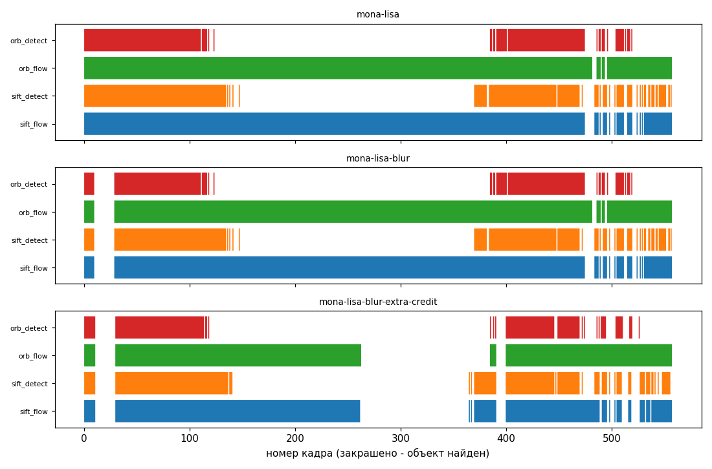
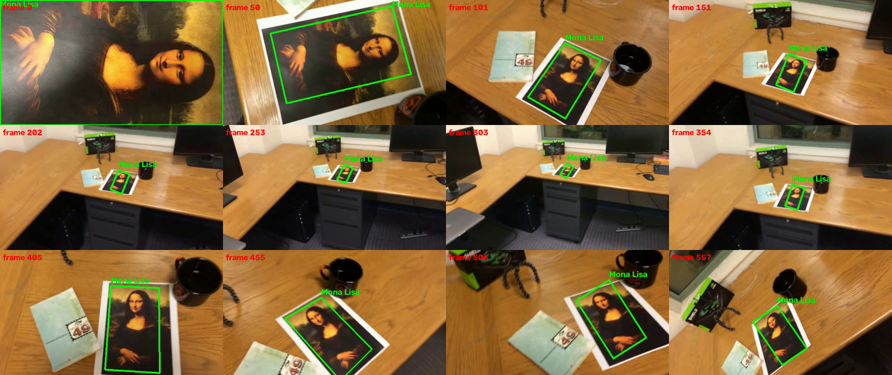
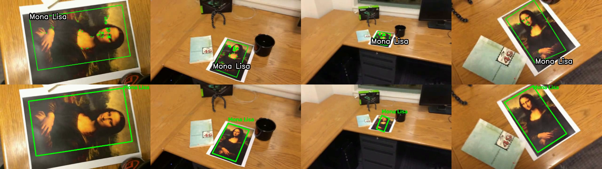

ЛР2. Трекинг плоского объекта на видео по ключевым точкам

Цель работы: реализовать простейший алгоритм трекинга объекта на видео на основе ключевых точек. Первый кадр видео - крупное изображение объекта (эталон). На каждом следующем кадре, где объект виден, вокруг него рисуется рамка с подписью, повторяющая положение и границы объекта.

1. Теоретическая база

Ключевая точка (keypoint) - заметное место изображения (угол, пятно, пересечение линий), которое можно находить повторно при изменении ракурса, масштаба и освещения. Дескриптор - числовой вектор, описывающий окрестность ключевой точки. Если дескрипторы двух точек близки, точки скорее всего соответствуют одному и тому же месту объекта.

Детекторы и дескрипторы, использованные в работе:
- SIFT (Scale-Invariant Feature Transform, Lowe, 2004). Ищет точки в пространстве масштабов (разности гауссианов), назначает каждой ориентацию и строит 128-мерный вещественный дескриптор. Инвариантен к масштабу и повороту, устойчив к небольшому размытию и смене освещения. Дескрипторы сравниваются евклидовым расстоянием (L2).
- ORB (Oriented FAST and Rotated BRIEF, Rublee, 2011). Быстрый бинарный аналог: точки FAST + бинарный дескриптор BRIEF с поворотом по ориентации. Дескрипторы сравниваются расстоянием Хэмминга (число различающихся бит). Работает в несколько раз быстрее SIFT, но менее устойчив к масштабу и размытию.

Сопоставление (matching). Для каждого дескриптора эталона ищутся два ближайших дескриптора кадра. Тест отношения Лоу (ratio test): сопоставление принимается, только если расстояние до первого соседа меньше 0.8 от расстояния до второго. Это отсеивает неоднозначные точки (повторяющиеся текстуры).

Гомография - преобразование, связывающее два изображения одной плоской поверхности, снятой с разных ракурсов. Задаётся матрицей 3x3 (8 степеней свободы): точка (x, y) переходит в (x', y') по формуле x' = (h11 x + h12 y + h13) / (h31 x + h32 y + h33), y' = (h21 x + h22 y + h23) / (h31 x + h32 y + h33). Объект в видео плоский (бумажная картина), поэтому гомографии достаточно, чтобы описать его положение. Минимум для оценки - 4 пары точек.

RANSAC (Random Sample Consensus) - устойчивая оценка модели при наличии выбросов. Много раз случайно выбираются минимальные наборы пар (4 для гомографии), по ним считается модель, подсчитывается число пар, согласующихся с ней (инлайеры, ошибка меньше порога в пикселях). Выбирается модель с максимумом инлайеров. Ложные сопоставления становятся выбросами и не портят результат.

Оптический поток Лукаса-Канаде (LK) - метод поиска смещения заданных точек между двумя соседними кадрами. Предполагает, что яркость точки не меняется, а смещение мало и одинаково в небольшом окне. Используется пирамида изображений для больших смещений. Проверка прямо-обратным потоком (forward-backward): точку переносят на следующий кадр и обратно, если она не вернулась в исходное место (ошибка более 1 пикселя), поток считается ненадёжным.

Аффинное преобразование подобия (поворот + масштаб + сдвиг, 4 степени свободы) - упрощённая модель. Требует меньше точек (минимум 2) и устойчивее при малом числе точек. Используется, когда точек для надёжной гомографии мало.

2. Описание разработанной системы

Файлы:

| Файл | Назначение |
|---|---|
| `tracker.py` | класс `ObjectTracker` (сам алгоритм) и функция `draw_box` (рисование рамки) |
| `run_tracking.py` | обработка одного видео: читает видео, запускает трекер, пишет видео с рамками и csv |
| `run_experiments.py` | запуск всех видео и конфигураций, сводная таблица, графики, контрольные кадры |
| `videos/` | исходные видео (3 тестовых, образец `simple_track.avi`) |
| `results/` | видео с рамками, csv по кадрам, картинки, таблица |

Запуск:

```bash
pip install -r ../requirements.txt
python run_tracking.py videos/mona-lisa.avi out.mp4          # одно видео
python run_tracking.py videos/mona-lisa.avi out.mp4 --detector orb --no-flow   # другой вариант
python run_experiments.py                                      # все эксперименты
```

Алгоритм (класс `ObjectTracker`):

Инициализация. Первый кадр видео переводится в оттенки серого, на нём находятся ключевые точки и дескрипторы эталона. Углы эталона - углы кадра (0,0), (w,0), (w,h), (0,h). Именно они затем переносятся на каждый кадр.

Обработка каждого кадра (метод `track`):
1. Детекция (`_detect`). На кадре находятся точки и дескрипторы, сопоставляются с эталоном (kNN, k=2, тест Лоу 0.8). Если хороших пар не меньше 10, по ним RANSAC считает гомографию (порог 5 пикселей). Инлайеры запоминаются как пары (точка эталона, точка кадра).
2. Поток (`_flow`). Если объект был найден на прошлом кадре, инлайеры прошлого кадра переносятся на новый кадр потоком LK. Оставляются только точки, прошедшие проверку прямо-обратным потоком. По ним оценивается новая гомография (порог 3 пикселя). Если точек меньше 25, вместо гомографии используется преобразование подобия: на малом числе точек гомография даёт искажённые рамки.
3. Выбор результата. Если детекция нашла 25 и более инлайеров - она надёжна и берётся (нет накопления ошибки потока). Иначе берётся результат потока, если он есть, иначе слабая детекция (10-24 инлайера). Если нет ни того, ни другого - на кадре объект не найден, состояние сбрасывается.
4. Проверка рамки. Рамка (4 угла = углы эталона, перенесённые гомографией) принимается, только если она выпуклая и её площадь разумна. Это отбрасывает вырожденные результаты.
5. Рисование. `draw_box` рисует зелёный четырёхугольник и подпись у верхнего угла.

Зачем поток вместе с детекцией. Когда камера отъезжает, картина занимает 50-100 пикселей, остаётся 5-15 совпавших точек, и чистая детекция (требует 10 и более) часто не срабатывает. Поток продолжает вести уже найденные точки и удерживает рамку. Чистая детекция даёт найденный объект лишь на 40-50% кадров (таблица ниже).

Параметры (все в конструкторе `ObjectTracker`): `ratio=0.8`, `min_inliers=10`, `min_flow_inliers=8`, `reliable_matches=25`, `min_homography_pts=25`.

3. Результаты работы и тестирование

Проверялись три тестовых видео (640x360, 558 кадров, объект - распечатанная Мона Лиза на столе): `mona-lisa.avi` (обычное), `mona-lisa-blur.avi` (размытое), `mona-lisa-blur-extra-credit.avi` (сильно размытое). Также приведён образец `simple_track.avi` - то же видео с рамкой, нарисованной авторами задания.

Сравнивались 4 конфигурации: SIFT + поток (основная), только SIFT-детекция, ORB + поток, только ORB-детекция. Метрика - на скольких кадрах из 558 найдена рамка (кадр 0 - сам эталон, рамка равна всему кадру).

| Видео | Конфигурация | Найден, кадров | Доля | Время, мс/кадр |
|---|---|---|---|---|
| mona-lisa | SIFT + поток | 528 / 558 | 94.6% | 101.7 |
| mona-lisa | SIFT детекция | 282 / 558 | 50.5% | 106.0 |
| mona-lisa | ORB + поток | 551 / 558 | 98.7% | 41.0 |
| mona-lisa | ORB детекция | 225 / 558 | 40.3% | 30.0 |
| mona-lisa-blur | SIFT + поток | 509 / 558 | 91.2% | 100.9 |
| mona-lisa-blur | SIFT детекция | 263 / 558 | 47.1% | 75.7 |
| mona-lisa-blur | ORB + поток | 532 / 558 | 95.3% | 31.2 |
| mona-lisa-blur | ORB детекция | 206 / 558 | 36.9% | 29.5 |
| mona-lisa-blur-extra-credit | SIFT + поток | 399 / 558 | 71.5% | 92.0 |
| mona-lisa-blur-extra-credit | SIFT детекция | 254 / 558 | 45.5% | 100.6 |
| mona-lisa-blur-extra-credit | ORB + поток | 408 / 558 | 73.1% | 31.2 |
| mona-lisa-blur-extra-credit | ORB детекция | 188 / 558 | 33.7% | 28.5 |

Время включает всю обработку кадра (детекция на каждом кадре), измерено на CPU. Таблица полностью в `results/summary.md`, результаты по кадрам в `results/*.csv`.

На графике закрашено, где объект найден (по кадрам, для всех конфигураций):



Видно, что конфигурации с потоком (первая и третья строки каждого видео) почти непрерывны, а чистая детекция отдельными вспышками, в основном в начале, когда объект крупный.

Выходные видео с рамками (основная конфигурация SIFT + поток): `results/mona-lisa_sift_flow.mp4`, `results/mona-lisa-blur_sift_flow.mp4`, `results/mona-lisa-blur-extra-credit_sift_flow.mp4`.

Контрольные кадры (12 равномерно по видео):

mona-lisa:


mona-lisa-blur:


mona-lisa-blur-extra-credit:


Сравнение с образцом (сверху кадры образца `simple_track.avi` с рамкой авторов задания, снизу наш результат на тех же кадрах):



Рамка ложится на границы картины, как и в образце. Образец рисует зелёные точки внутри рамки, у нас рисуется только рамка и подпись. Различие: на дальнем плане рамка немного уже, чем в образце, так как при малом числе точек используется модель подобия (без перспективы).

Проверка результатов. Все выходные видео и контрольные кадры просмотрены вручную. Дополнительно проверено численно: у основной конфигурации нет скачков рамки между соседними кадрами (среднее смещение углов не более 40 пикселей ни на одной паре кадров); положения рамок SIFT + поток и ORB + поток совпадают в среднем с точностью около 5 пикселей на видео без сильного размытия.

Где объект не найден:
- mona-lisa и blur: кадры 475-530 (разрозненные), камера движется быстро, сильное смазывание от движения.
- blur и extra-credit: кадры 10-29, начало видео размыто сильнее всего.
- extra-credit: кадры 262-364, объект мал (около 50 пикселей) и сильно размыт, точек недостаточно.
Ложных срабатываний на тестовых видео не обнаружено (объект на них всегда в кадре, поэтому проверить отсутствие объекта нельзя - это ограничение тестовых данных).

3.5. Собственное видео

Раздел будет дополнен после съёмки собственного видео с похожим объектом (см. команду запуска выше: `python run_tracking.py videos/my_video.mp4 results/my_video.mp4 --label "Название"`).

4. Выводы по работе

1. Реализован трекер плоского объекта: ключевые точки SIFT/ORB, сопоставление с тестом Лоу, гомография по RANSAC, перенос углов эталона на кадр. Рамка точно следует за границами картины при поворотах, наклонах, приближении и удалении камеры.
2. Одной детекции недостаточно: когда объект мал или размыт, совпавших точек мало, и рамка находится лишь на 34-50% кадров. Добавление оптического потока LK с проверкой прямо-обратным потоком поднимает результат до 92-95% на нормальном и размытом видео и до 72% на сильно размытом.
3. Гомография неустойчива при малом числе точек (искажённые рамки), поэтому при менее 25 точек используется модель подобия, а надёжная детекция (25 и более инлайеров) имеет приоритет над потоком, чтобы сбрасывать накопленный дрейф.
4. SIFT устойчивее ORB к масштабу и размытию, но втрое медленнее (около 100 против 30-40 мс на кадр). В конфигурации с потоком ORB дал сопоставимую долю найденных кадров и совпал с SIFT по положению рамки, но детекция сама по себе у ORB хуже.
5. Ограничения: при потере объекта поиск идёт по всему кадру (нет предсказания положения по движению), обработка не в реальном времени для SIFT, объект должен быть плоским и текстурным, при сильном размытии и очень малом размере объект теряется.

5. Использованные источники

1. Lowe D. G. Distinctive Image Features from Scale-Invariant Keypoints. IJCV, 2004.
2. Rublee E., Rabaud V., Konolige K., Bradski G. ORB: an efficient alternative to SIFT or SURF. ICCV, 2011.
3. Fischler M., Bolles R. Random Sample Consensus. CACM, 1981.
4. Lucas B., Kanade T. An Iterative Image Registration Technique with an Application to Stereo Vision. IJCAI, 1981.
5. Документация OpenCV: Feature Matching + Homography to find Objects - https://docs.opencv.org/4.x/d1/de0/tutorial_py_feature_homography.html
6. Документация OpenCV: Optical Flow - https://docs.opencv.org/4.x/d4/dee/tutorial_optical_flow.html
7. Hartley R., Zisserman A. Multiple View Geometry in Computer Vision. Cambridge University Press, 2003 (гомография).
