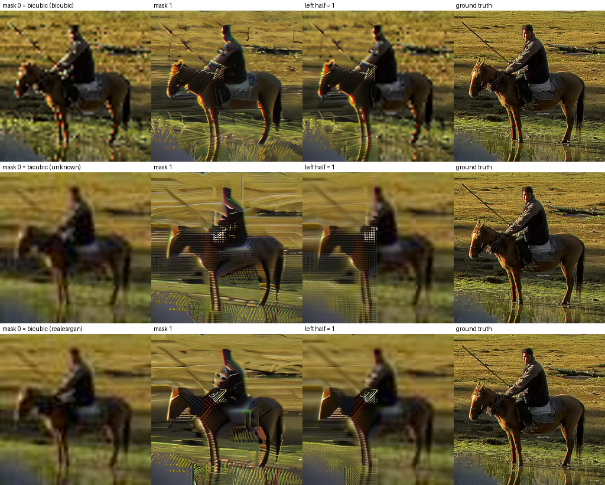
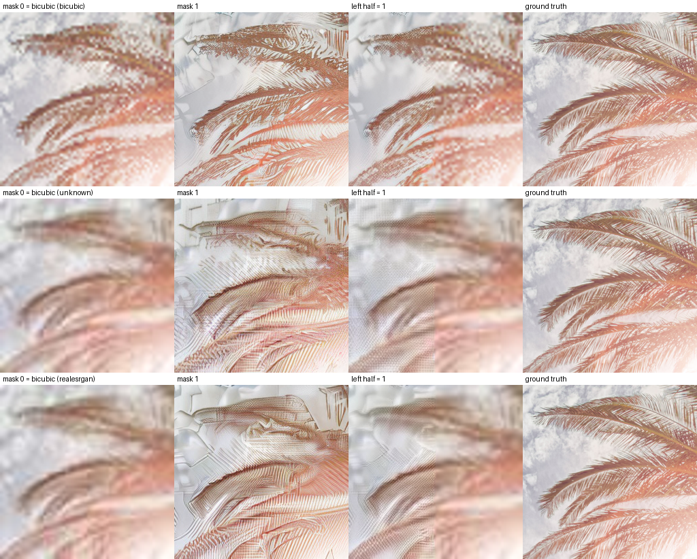
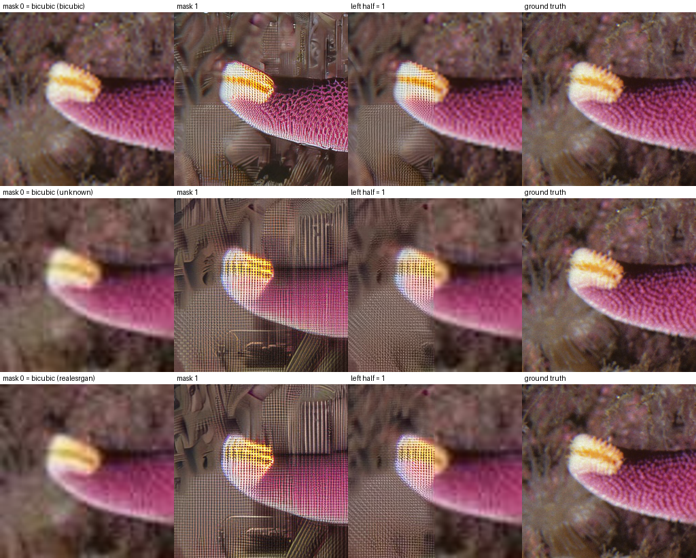
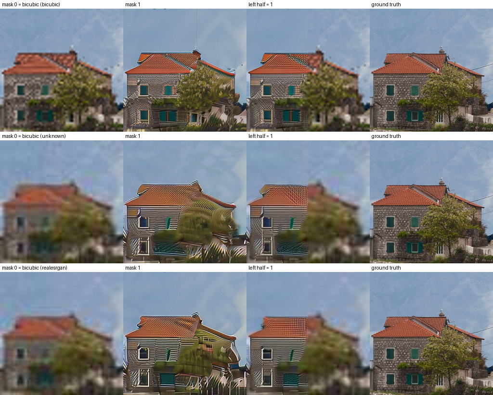

ЛР3.2. SR-inpainting на диффузионной модели

Цель работы: разобраться в устройстве диффузионных image-to-image моделей и изменить процесс сэмплинга так, чтобы улучшалась только та часть изображения, которая задана бинарной маской.

Системные требования: Python 3.11, PyTorch (CPU достаточно), diffusers 0.35, transformers, lpips, torchmetrics, pandas, matplotlib, opencv-python, pillow. Результаты получены на ноутбуке без GPU (8 ядер CPU, 8 ГБ ОЗУ), один прогон диффузии на изображении 256x256 занимает около 110 с. Запуск: `python run_sr_experiments.py`, затем `python make_sr_report.py`.

1. Теоретическая база

Диффузионная модель (DDPM, Ho et al., 2020) учится обращать процесс зашумления: к изображению (или его латентному представлению) постепенно, за T шагов добавляется гауссов шум, пока не останется чистый шум. Нейросеть (обычно U-Net) обучается по зашумлённому x_t и номеру шага t предсказывать добавленный шум (или близкую величину, v-предсказание). Генерация: начинаем с шума и шаг за шагом убираем его. Сэмплер DDIM позволяет делать это за небольшое число шагов (у нас 15).

Latent diffusion (Rombach et al., 2022): диффузия идёт не в пикселях, а в латентном пространстве автоэнкодера (VAE), что делает вычисления существенно дешевле. VAE кодирует картинку в латентный тензор и декодирует обратно.

Image-to-image и super-resolution: модель получает дополнительное условие (здесь - изображение низкого разрешения, конкатенируется к латентам по каналам) и генерирует изображение высокого разрешения. Stable Diffusion x4 Upscaler (Stability AI) - латентная диффузионная модель, увеличивающая изображение в 4 раза, с условием по LR-картинке и уровню шума noise_level, которым LR-вход зашумляется при обучении (устойчивость к артефактам входа). SUPIR, предложенная в задании модель, устроена сложнее (SDXL + адаптер + текстовые описания) и требует GPU с 24+ ГБ; на моём CPU без GPU запустить её невозможно, поэтому использована более лёгкая модель того же класса.

Inpainting с помощью диффузии без дообучения (идея RePaint, Lugmayr et al., 2022, и Blended Diffusion, Avrahami et al., 2022): на каждом шаге обратного процесса область вне маски заменяется на известное изображение, зашумлённое до текущего уровня шума, а внутри маски остаётся результат модели. Тогда модель генерирует только внутри маски, согласуясь с окружающим.

Метрики:
- PSNR = 10 log10(255^2 / MSE), дБ. Измеряет пиксельное сходство с эталоном (выше лучше). Сильно штрафует любые отличия, поэтому размытый, но «усреднённый» результат часто имеет PSNR выше, чем резкий, с дорисованными деталями.
- LPIPS (Zhang et al., 2018) - расстояние между глубокими признаками сетей (AlexNet), хорошо коррелирует с восприятием (ниже лучше).
- CLIP-IQA (Wang et al., 2023) - безэталонная оценка качества: сравнивается сходство картинки в пространстве CLIP с парой текстов «Good photo» и «Bad photo» (выше лучше). Эталон не требуется, поэтому метрика оценивает вид картинки, а не соответствие оригиналу и может «хвалить» выдуманные детали.

2. Описание разработанной системы

Файлы:

| Файл | Назначение |
|---|---|
| `sr_inpaint.py` | модифицированный сэмплинг: функция `sr_inpaint(pipe, lr, mask)` |
| `run_sr_experiments.py` | деградации, маски, прогон, метрики PSNR/LPIPS/CLIP-IQA |
| `make_sr_report.py` | сводные таблицы и сравнительные картинки |
| `results_sr/` | результаты (картинки, `metrics.csv`, `summary.md`) |

Алгоритм `sr_inpaint` (за основу взят цикл сэмплинга из `StableDiffusionUpscalePipeline` библиотеки diffusers, он переписан вручную):
1. LR-изображение переводится в [-1,1]; из него строится bicubic-увеличение x4 (изображение без улучшения).
2. Bicubic-изображение кодируется VAE в латенты z_known. Маска (в разрешении выходного изображения) приводится к сетке латентов.
3. Подготовка условия: LR-вход зашумляется до noise_level = 20 (как в оригинальном пайплайне).
4. Старт: случайный шум в латентах. Цикл по 15 шагам DDIM: U-Net предсказывает шум по [латенты, LR-условие], шаг сэмплера даёт латенты следующего шага.
5. Изменение сэмплинга: после каждого шага латенты смешиваются по маске: latents = M * latents + (1 - M) * noisy(z_known, t_next), где noisy - z_known, зашумлённое до уровня следующего шага (на последнем шаге - z_known без шума). Область M = 1 генерируется моделью, область M = 0 остаётся «известной».
6. Декодирование VAE и финальное смешивание в пикселях: out = M * SR + (1 - M) * bicubic, чтобы вне маски результат в точности совпадал с bicubic-увеличением (тем же, что получается при маске из нулей).
7. Если маска целиком нулевая, диффузия не запускается (результат по построению равен bicubic).

Принятые упрощения (из-за CPU): guidance (CFG) отключён (guidance = 1) и пустой промпт; 15 шагов вместо стандартных 75; изображения маленькие: HR-кроп 256x256, LR-вход 64x64.

Тестовые данные: 4 кропа 256x256 из DIV2K (train HR, изображения 0001-0004: морская звезда, всадник, пальма, дома у воды). Три деградации (LR 64x64):
- bicubic: bicubic-уменьшение в 4 раза;
- unknown: Gaussian blur (sigma 2) + bicubic x1/4 + гауссов шум (sigma 6) + JPEG качества 60;
- realesrgan: упрощённая имитация деградаций Real-ESRGAN: двухступенчатое размытие, ресайз, шум, JPEG (это моя имитация по описанию, а не код Real-ESRGAN).
Три маски: все единицы (улучшать всё), все нули (ничего не улучшать), комбинированная (левая половина = 1, правая = 0). Всего 36 пар (изображение, деградация, маска). Один seed.

3. Результаты работы и тестирование

Средние метрики по 4 изображениям (PSNR выше - лучше, LPIPS ниже - лучше, CLIP-IQA выше - лучше). Метрики считались по всему выходному изображению относительно оригинала (PSNR, LPIPS) и без эталона (CLIP-IQA):

| Деградация | Маска | PSNR, дБ | LPIPS | CLIP-IQA |
|---|---|---|---|---|
| bicubic | все 0 (bicubic) | 24.53 | 0.521 | 0.632 |
| bicubic | все 1 | 20.30 | 0.396 | 0.832 |
| bicubic | левая половина 1 | 22.60 | 0.471 | 0.688 |
| unknown | все 0 (bicubic) | 23.30 | 0.758 | 0.444 |
| unknown | все 1 | 19.26 | 0.572 | 0.576 |
| unknown | левая половина 1 | 21.42 | 0.681 | 0.498 |
| realesrgan | все 0 (bicubic) | 23.46 | 0.741 | 0.527 |
| realesrgan | все 1 | 18.59 | 0.555 | 0.796 |
| realesrgan | левая половина 1 | 21.29 | 0.646 | 0.585 |

PSNR по половинам для комбинированной маски, дБ:

| Деградация | левая: bicubic | левая: SR (маска 1) | левая: комб. маска | правая: bicubic | правая: комб. маска |
|---|---|---|---|---|---|
| bicubic | 25.00 | 20.53 | 21.64 | 24.27 | 24.27 |
| unknown | 23.56 | 19.01 | 20.39 | 23.17 | 23.17 |
| realesrgan | 23.73 | 18.43 | 20.13 | 23.31 | 23.31 |

Полные результаты по каждому изображению - `results_sr/metrics.csv`, сводка - `results_sr/summary.md`. Среднее время одного прогона диффузии на CPU - 111 с.

Сравнительные рисунки (строки: деградации bicubic, unknown, realesrgan; столбцы: маска 0 = bicubic, маска 1, левая половина = 1, оригинал):

Закономерности:
- Маска работает как задумано. На комбинированной маске левая половина получает дорисованные детали, правая в точности совпадает с bicubic (PSNR правой половины 24.27, 23.17 и 23.31 дБ, как и при маске из нулей), шов проходит строго по границе маски.
- Маска из нулей по построению даёт bicubic и лучший PSNR; маска из единиц даёт лучший LPIPS и CLIP-IQA. Комбинированная маска лежит между ними по всем метрикам, как и должно быть для картинки, наполовину улучшенной.
- Метрики расходятся: PSNR падает на 4-5 дБ после SR, а LPIPS и CLIP-IQA улучшаются. Причина: диффузионная модель дорисовывает правдоподобные, но не совпадающие с оригиналом детали (текстуры, края). Они выглядят резче и «реальнее» (выше CLIP-IQA, ниже LPIPS), но пиксель в пиксель не совпадают с исходником, поэтому PSNR хуже. Это классический компромисс между искажением и восприятием.
- Влияние деградации. На bicubic-деградации SR даёт заметное улучшение (см. рисунок с всадником: чёткие контуры лошади и всадника). На более жёстких деградациях (unknown, realesrgan: сильное размытие, шум, JPEG) выигрыш по LPIPS есть, но визуально результат хуже: модель сильно выдумывает детали, видны сетчатые и полосатые артефакты, искажения форм (рисунки с пальмой и морской звездой). Модель обучалась на вход 128x128 и более, при нашем 64x64 и без текстового описания (guidance = 1) она слабее «понимает» содержимое.
- CLIP-IQA нужно трактовать осторожно: безэталонная метрика иногда высоко оценивает картинки с выдуманными деталями, поэтому её значения следует читать вместе с LPIPS и визуальной проверкой.

4. Выводы по работе

1. Реализован SR-inpainting для предобученной диффузионной модели Stable Diffusion x4 Upscaler путём изменения процесса сэмплинга (подмена области вне маски зашумлённым известным изображением на каждом шаге и финальное пиксельное смешивание), без дообучения.
2. Протестированы маски (все 1, все 0, комбинированная) на трёх деградациях; поведение соответствует ожиданиям: при маске из нулей результат равен bicubic, при комбинированной неулучшаемая часть совпадает с bicubic.
3. PSNR и перцептивные метрики (LPIPS, CLIP-IQA) движутся в разные стороны; для оценки генеративных SR-моделей PSNR недостаточен.
4. На сильно деградированных входах малого размера модель дорисовывает ложные детали.

5. Использованные источники

1. Ho J., Jain A., Abbeel P. Denoising Diffusion Probabilistic Models. NeurIPS, 2020.
2. Song J., Meng C., Ermon S. Denoising Diffusion Implicit Models. ICLR, 2021.
3. Rombach R. et al. High-Resolution Image Synthesis with Latent Diffusion Models. CVPR, 2022.
4. Lugmayr A. et al. RePaint: Inpainting using Denoising Diffusion Probabilistic Models. CVPR, 2022.
5. Avrahami O., Lischinski D., Fried O. Blended Diffusion for Text-driven Editing of Natural Images. CVPR, 2022.
6. Zhang R. et al. The Unreasonable Effectiveness of Deep Features as a Perceptual Metric (LPIPS). CVPR, 2018.
7. Wang J., Chan K., Loy C. Exploring CLIP for Assessing the Look and Feel of Images (CLIP-IQA). AAAI, 2023.
8. Yu F. et al. Scaling Up to Excellence: Practicing Model Scaling for Photo-Realistic Image Restoration In the Wild (SUPIR). CVPR, 2024.
9. Agustsson E., Timofte R. NTIRE 2017 Challenge on Single Image Super-Resolution: Dataset and Study (DIV2K). CVPRW, 2017.
10. Документация Hugging Face diffusers (StableDiffusionUpscalePipeline), модель stabilityai/stable-diffusion-x4-upscaler.
