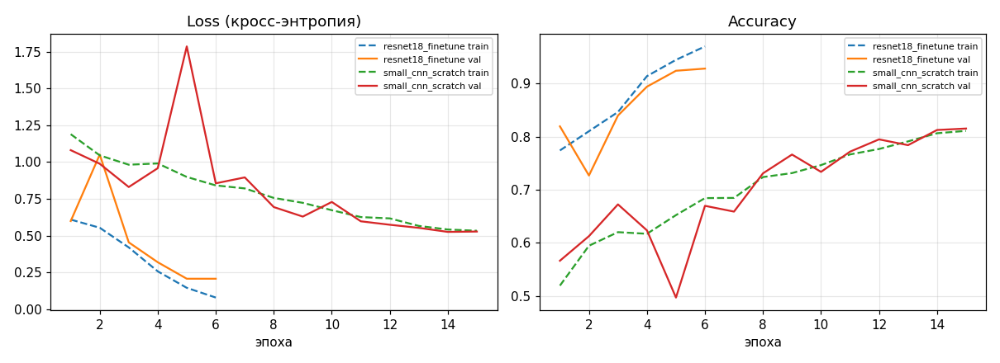
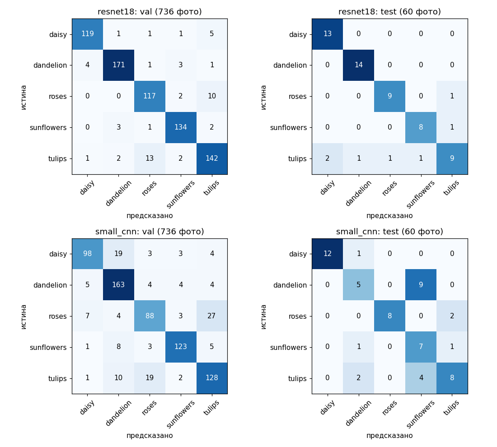
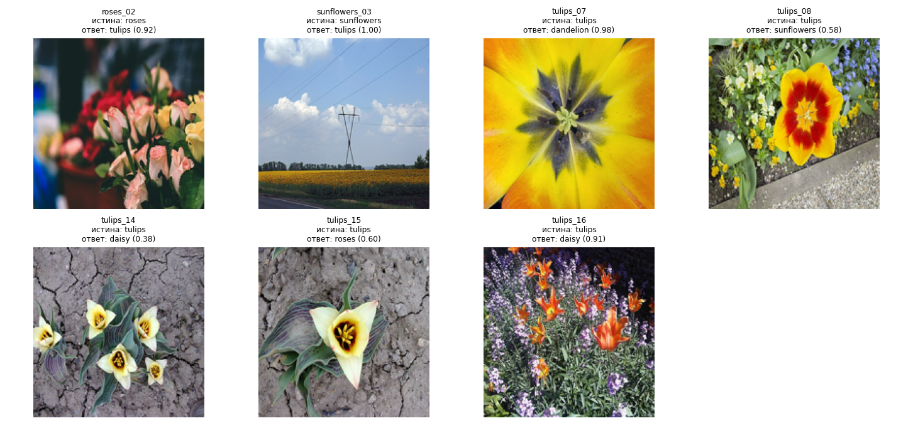
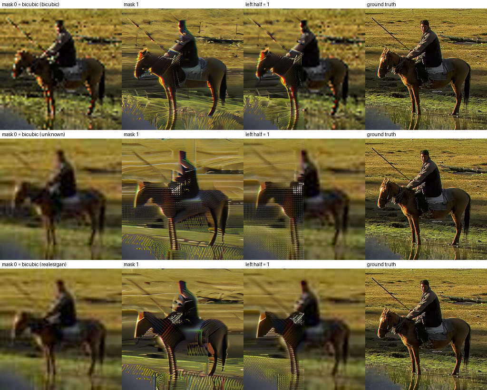
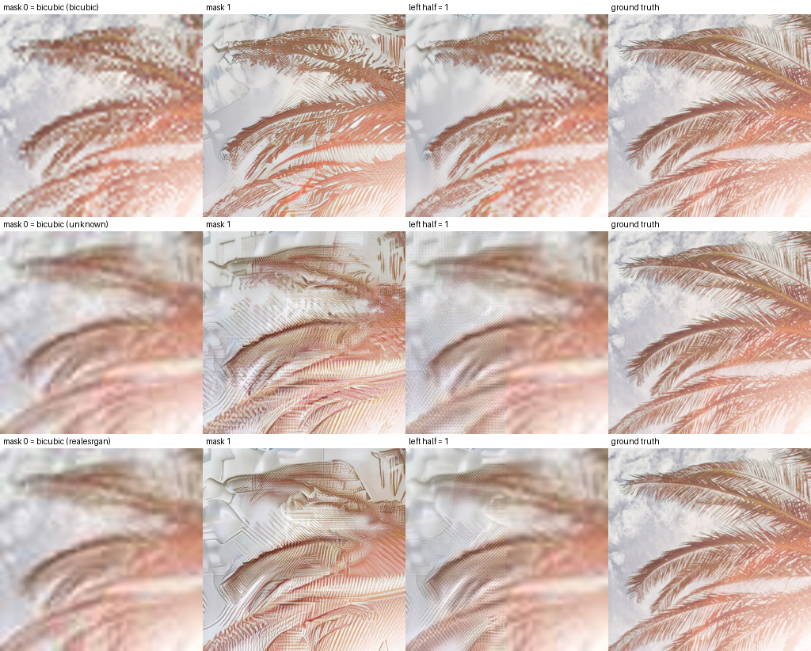
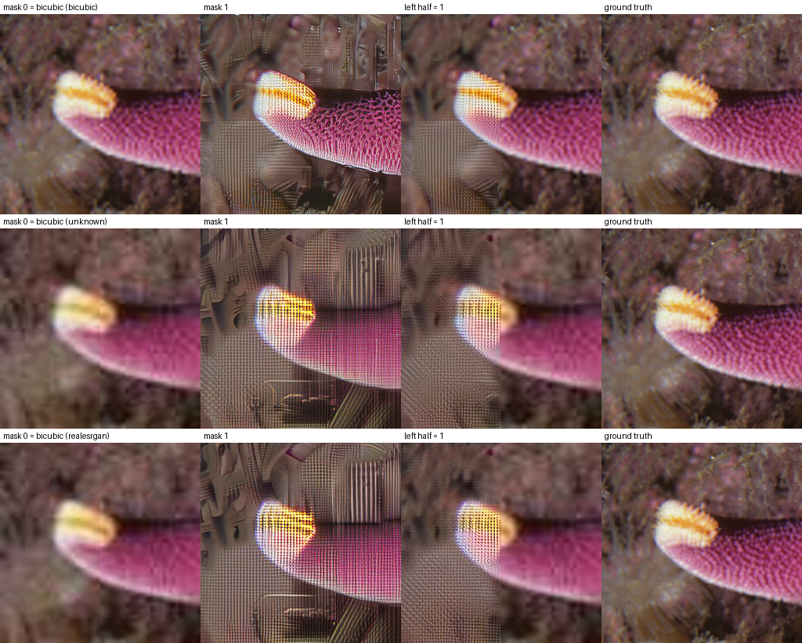
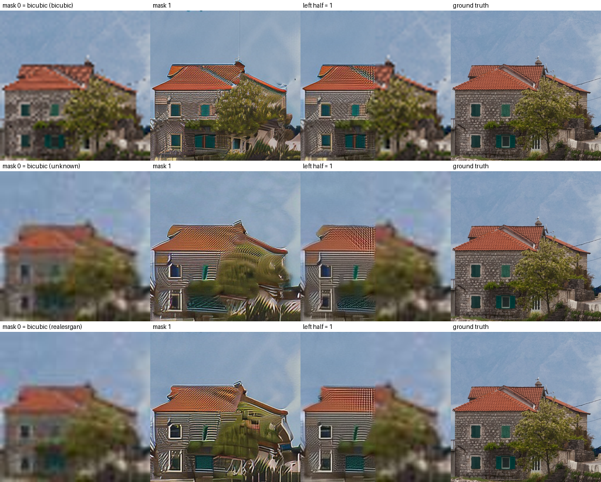

ЛР3. Классификация изображений на CNN (3.1) и SR-inpainting на диффузионной модели (3.2)

Цель работы 3.1: научиться создавать простые системы классификации изображений на основе сверточных нейронных сетей. Цель работы 3.2: разобраться в устройстве диффузионных image-to-image моделей и изменить процесс сэмплинга так, чтобы улучшалась только часть изображения, заданная маской.

Системные требования: Python 3.11, PyTorch (CPU достаточно), torchvision, diffusers 0.35, transformers, lpips, torchmetrics, scikit-learn, pandas, pyarrow, matplotlib, opencv-python, pillow. Все результаты получены на ноутбуке без GPU (8 ядер CPU, 8 ГБ ОЗУ). Обучение ResNet18 заняло около 1 часа, один прогон диффузии на изображении 256x256 - около 110 с.

Часть 3.1. Классификация цветов

1. Теоретическая база

Свёрточная нейронная сеть (CNN) - нейросеть, в которой первые слои - свёртки: небольшие обучаемые фильтры (например 3x3) скользят по изображению и вычисляют отклик на локальные узоры (края, пятна, текстуры). Слои чередуются с нелинейностью ReLU и пулингом (уменьшение разрешения), поэтому глубокие слои видят всё более крупные и абстрактные признаки. В конце признаки сводятся в вектор и подаются в полносвязный слой, выдающий оценки (логиты) для каждого класса.

ResNet (He et al., 2015) - глубокая CNN с остаточными связями: блок вычисляет y = F(x) + x. Это упрощает обучение глубоких сетей. ResNet18 содержит 18 слоёв, около 11.7 млн параметров.

Перенос обучения (fine-tuning): сеть, предобученную на большом датасете ImageNet (1.2 млн изображений, 1000 классов), используют как готовый извлекатель признаков, заменяют последний слой на новый (по числу наших классов) и дообучают всю сеть на небольшом датасете. Это даёт высокое качество при малом числе данных и быстрой сходимости.

Функция потерь - кросс-энтропия: L = -log(p_y), где p_y - вероятность правильного класса после softmax. Чем увереннее и правильнее ответ, тем ниже loss.

Метрики: accuracy - доля верных ответов; precision класса - доля верных среди предсказанных этим классом; recall - доля найденных среди всех объектов класса; F1 - гармоническое среднее precision и recall; macro-F1 - среднее F1 по классам. Confusion matrix - таблица (истинный класс x предсказанный).

Переобучение - ситуация, когда модель хорошо запоминает обучающую выборку, но хуже работает на новых данных. Признак: train loss продолжает падать, а val loss перестаёт падать или растёт, растёт разрыв между train и val accuracy.

Аугментация - случайные преобразования обучающих картинок (кроп, отражение), увеличивающие разнообразие данных и снижающие переобучение.

2. Описание разработанной системы

Задача: определить вид цветка на фото, 5 классов - daisy (ромашка), dandelion (одуванчик), roses (розы), sunflowers (подсолнухи), tulips (тюльпаны).

Данные:
- train/val: датасет tf_flowers (3670 фото; взят копией на Hugging Face Falah/Flowers_Classification). Стратифицированное разбиение 80/20 с фиксированным seed: 2934 train и 736 val.
- test: собран и размечен отдельно, 60 фото с Wikimedia Commons (daisy 13, dandelion 14, roses 10, sunflowers 9, tulips 14). Разметка - по категории Commons, из которой взято фото; затем я просмотрел все кандидаты и удалил неподходящие (цветок не виден, другой цветок, почтовые марки). Источники, авторы и лицензии - в `test_images/sources.csv`. Test не использовался при обучении и выборе гиперпараметров.

Файлы:

| Файл | Назначение |
|---|---|
| `train.py` | загрузка данных, аугментации, обучение ResNet18 и маленькой CNN |
| `evaluate.py` | метрики на val и test, графики, confusion matrix, ошибки |
| `collect_test.py` | скачивание кандидатов в тест с Wikimedia Commons и ручная чистка |
| `test_images/` | тестовая выборка (60 фото) и `sources.csv` |
| `results/` | графики, метрики, предсказания |

Запуск: положить parquet датасета в `data/flowers.parquet`, затем `python train.py` и `python evaluate.py`.

Архитектуры (зафиксированы):
1. ResNet18, предобученная на ImageNet; последний слой заменён на Linear(512, 5). Дообучаются все слои. AdamW, lr 1e-3 с расписанием OneCycle, weight decay 1e-4, батч 32, 6 эпох.
2. Базовая маленькая CNN с нуля: 4 блока Conv3x3 + BatchNorm + ReLU + MaxPool (32, 64, 128, 256 каналов), глобальный average pooling, Dropout 0.3, Linear(256, 5). AdamW, lr 3e-3 OneCycle, 15 эпох. Нужна для сравнения: что даёт предобучение.

Общее: вход 160x160. Все фото приведены к 176x176; при обучении случайный кроп 160x160 и случайное горизонтальное отражение, при проверке - центральный кроп. Нормализация статистиками ImageNet. Loss - кросс-энтропия. Метрики - accuracy и macro-F1.

3. Результаты работы и тестирование

Кривые обучения (пунктир - train, сплошная - val; train считается по аугментированным батчам в ходе эпохи):

Итоговые метрики:

| Модель | Val accuracy | Val macro-F1 | Test accuracy (60 фото) | Test macro-F1 |
|---|---|---|---|---|
| ResNet18 (fine-tune) | 0.928 | 0.927 | 0.883 | 0.881 |
| Малая CNN с нуля | 0.815 | 0.812 | 0.667 | 0.681 |

Значения по классам (precision/recall/F1) - в `results/metrics.md`.

Confusion matrix (слева val, справа test):

Ошибки ResNet18 на test (7 из 60):

Закономерности и анализ:
- Переобучение ResNet18. К шестой эпохе train accuracy 0.970, val accuracy 0.928; train loss 0.079, val loss 0.207. Val loss не растёт, а падает вместе с train loss (минимум на последней эпохе), поэтому сильного переобучения нет. Разрыв train/val небольшой и ожидаемый.
- Малая CNN недообучена, а не переобучена: к 15 эпохе train 0.811, val 0.815, обе кривые ещё идут вниз. Ей не хватает эпох и/или данных; предобученная модель выигрывает 11 п.п. на val за 6 эпох.
- Test ниже val (0.883 против 0.928 у ResNet18, 0.667 против 0.815 у малой CNN). Это ожидаемо: test взят из другого источника (Wikimedia, другие фотографы, условия съёмки, композиция), а не из того же распределения, что train/val. Малая CNN сильнее теряет при смене распределения (особенно dandelion: recall 0.36 и sunflowers: precision 0.35).
- Ошибки ResNet18 на test: 5 из 7 приходятся на тюльпаны (recall 0.64). Это раскрытые тюльпаны с необычной формой, цветочные поля с мелкими цветами и снимки с множеством разных цветов. На val тюльпаны и розы также самые трудные классы (F1 0.89). Две ошибки (роза -> тюльпан, подсолнух -> тюльпан) сделаны с высокой уверенностью (0.92 и 1.00): модель переоценивает себя на нетипичных кадрах.

Часть 3.2. SR-inpainting на диффузионной модели

1. Теоретическая база

Диффузионная модель (DDPM, Ho et al., 2020) учится обращать процесс зашумления: к изображению (или его латентному представлению) постепенно, за T шагов добавляется гауссов шум, пока не останется чистый шум. Нейросеть (обычно U-Net) обучается по зашумлённому x_t и номеру шага t предсказывать добавленный шум (или близкую величину, v-предсказание). Генерация: начинаем с шума и шаг за шагом убираем его. Сэмплер DDIM позволяет делать это за небольшое число шагов (у нас 15).

Latent diffusion (Rombach et al., 2022): диффузия идёт не в пикселях, а в латентном пространстве автоэнкодера (VAE), что делает вычисления существенно дешевле. VAE кодирует картинку в латентный тензор и декодирует обратно.

Image-to-image и super-resolution: модель получает дополнительное условие (здесь - изображение низкого разрешения, конкатенируется к латентам по каналам) и генерирует изображение высокого разрешения. Stable Diffusion x4 Upscaler (Stability AI) - латентная диффузионная модель, увеличивающая изображение в 4 раза, с условием по LR-картинке и уровню шума noise_level, которым LR-вход зашумляется при обучении (устойчивость к артефактам входа). SUPIR, предложенная в задании модель, устроена сложнее (SDXL + адаптер + текстовые описания) и требует GPU с 24+ ГБ; на моём CPU без GPU запустить её невозможно, поэтому использована более лёгкая модель того же класса.

Inpainting с помощью диффузии без дообучения (идея RePaint, Lugmayr et al., 2022, и Blended Diffusion, Avrahami et al., 2022): на каждом шаге обратного процесса область вне маски заменяется на известное изображение, зашумлённое до текущего уровня шума, а внутри маски остаётся результат модели. Тогда модель генерирует только внутри маски, согласуясь с окружающим.

Метрики:
- PSNR = 10 log10(255^2 / MSE), дБ. Измеряет пиксельное сходство с эталоном (выше лучше). Сильно штрафует любые отличия, поэтому размытый, но «усреднённый» результат часто имеет PSNR выше, чем резкий, с дорисованными деталями.
- LPIPS (Zhang et al., 2018) - расстояние между глубокими признаками сетей (AlexNet), хорошо коррелирует с восприятием (ниже лучше).
- CLIP-IQA (Wang et al., 2023) - безэталонная оценка качества: сравнивается сходство картинки в пространстве CLIP с парой текстов «Good photo» и «Bad photo» (выше лучше). Эталон не требуется, поэтому метрика оценивает вид картинки, а не соответствие оригиналу и может «хвалить» выдуманные детали.

2. Описание разработанной системы

Файлы:

| Файл | Назначение |
|---|---|
| `sr_inpaint.py` | модифицированный сэмплинг: функция `sr_inpaint(pipe, lr, mask)` |
| `run_sr_experiments.py` | деградации, маски, прогон, метрики PSNR/LPIPS/CLIP-IQA |
| `make_sr_report.py` | сводные таблицы и сравнительные картинки |
| `results_sr/` | результаты (картинки, `metrics.csv`, `summary.md`) |

Алгоритм `sr_inpaint` (за основу взят цикл сэмплинга из `StableDiffusionUpscalePipeline` библиотеки diffusers, он переписан вручную):
1. LR-изображение переводится в [-1,1]; из него строится bicubic-увеличение x4 (изображение без улучшения).
2. Bicubic-изображение кодируется VAE в латенты z_known. Маска (в разрешении выходного изображения) приводится к сетке латентов.
3. Подготовка условия: LR-вход зашумляется до noise_level = 20 (как в оригинальном пайплайне).
4. Старт: случайный шум в латентах. Цикл по 15 шагам DDIM: U-Net предсказывает шум по [латенты, LR-условие], шаг сэмплера даёт латенты следующего шага.
5. Изменение сэмплинга: после каждого шага латенты смешиваются по маске: latents = M * latents + (1 - M) * noisy(z_known, t_next), где noisy - z_known, зашумлённое до уровня следующего шага (на последнем шаге - z_known без шума). Область M = 1 генерируется моделью, область M = 0 остаётся «известной».
6. Декодирование VAE и финальное смешивание в пикселях: out = M * SR + (1 - M) * bicubic, чтобы вне маски результат точно совпадал с bicubic.
7. Если маска целиком нулевая, диффузия не запускается (результат по построению равен bicubic).

Принятые упрощения (из-за CPU): guidance (CFG) отключён (guidance = 1) и пустой промпт; 15 шагов вместо стандартных 75; изображения маленькие: HR-кроп 256x256, LR-вход 64x64.

Тестовые данные: 4 кропа 256x256 из DIV2K (train HR, изображения 0001-0004: морская звезда, всадник, пальма, дома у воды). Три деградации (LR 64x64):
- bicubic: bicubic-уменьшение в 4 раза;
- unknown: Gaussian blur (sigma 2) + bicubic x1/4 + гауссов шум (sigma 6) + JPEG качества 60;
- realesrgan: упрощённая имитация деградаций Real-ESRGAN: двухступенчатое размытие, ресайз, шум, JPEG (это моя имитация по описанию, а не код Real-ESRGAN).
Три маски: все единицы (улучшать всё), все нули (ничего не улучшать), комбинированная (левая половина = 1, правая = 0). Всего 36 пар (изображение, деградация, маска). Один seed.

3. Результаты работы и тестирование

Средние метрики по 4 изображениям (PSNR выше - лучше, LPIPS ниже - лучше, CLIP-IQA выше - лучше). Метрики считались по всему выходному изображению относительно оригинала (PSNR, LPIPS) и без эталона (CLIP-IQA):

| Деградация | Маска | PSNR, дБ | LPIPS | CLIP-IQA |
|---|---|---|---|---|
| bicubic | все 0 (bicubic) | 24.53 | 0.521 | 0.632 |
| bicubic | все 1 | 20.30 | 0.396 | 0.832 |
| bicubic | левая половина 1 | 22.54 | 0.477 | 0.742 |
| unknown | все 0 (bicubic) | 23.30 | 0.758 | 0.444 |
| unknown | все 1 | 19.26 | 0.572 | 0.576 |
| unknown | левая половина 1 | 21.43 | 0.681 | 0.514 |
| realesrgan | все 0 (bicubic) | 23.46 | 0.741 | 0.527 |
| realesrgan | все 1 | 18.59 | 0.555 | 0.796 |
| realesrgan | левая половина 1 | 21.30 | 0.646 | 0.570 |

PSNR по половинам для комбинированной маски, дБ:

| Деградация | левая: bicubic | левая: SR (маска 1) | левая: комб. маска | правая: bicubic | правая: комб. маска |
|---|---|---|---|---|---|
| bicubic | 25.00 | 20.53 | 21.64 | 24.27 | 24.13 |
| unknown | 23.56 | 19.01 | 20.39 | 23.17 | 23.18 |
| realesrgan | 23.73 | 18.43 | 20.13 | 23.31 | 23.33 |

Полные результаты по каждому изображению - `results_sr/metrics.csv`, сводка - `results_sr/summary.md`. Среднее время одного прогона диффузии на CPU - 111 с.

Сравнительные рисунки (строки: деградации bicubic, unknown, realesrgan; столбцы: маска 0 = bicubic, маска 1, левая половина = 1, оригинал):

Закономерности:
- Маска работает как задумано. На комбинированной маске левая половина получает дорисованные детали, правая выглядит как исходный bicubic, шов проходит строго по границе маски. PSNR правой половины с комбинированной маской совпадает с bicubic (24.13 против 24.27, 23.18 против 23.17, 23.33 против 23.31 дБ; остаточное расхождение до 0.14 дБ связано с тем, что внутри функции bicubic считается в torch, а базовая картинка маски 0 - в PIL, у них немного различаются реализации bicubic).
- Маска из нулей по построению даёт bicubic и лучший PSNR; маска из единиц даёт лучший LPIPS и CLIP-IQA. Комбинированная маска лежит между ними по всем метрикам, как и должно быть для картинки, наполовину улучшенной.
- Метрики расходятся: PSNR падает на 4-5 дБ после SR, а LPIPS и CLIP-IQA улучшаются. Причина: диффузионная модель дорисовывает правдоподобные, но не совпадающие с оригиналом детали (текстуры, края). Они выглядят резче и «реальнее» (выше CLIP-IQA, ниже LPIPS), но пиксель в пиксель не совпадают с исходником, поэтому PSNR хуже. Это классический компромисс между искажением и восприятием.
- Влияние деградации. На bicubic-деградации SR даёт заметное улучшение (см. рисунок с всадником: чёткие контуры лошади и всадника). На более жёстких деградациях (unknown, realesrgan: сильное размытие, шум, JPEG) выигрыш по LPIPS есть, но визуально результат хуже: модель сильно выдумывает детали, видны сетчатые и полосатые артефакты, искажения форм (рисунки с пальмой и морской звездой). Модель обучалась на вход 128x128 и более, при нашем 64x64 и без текстового описания (guidance = 1) она слабее «понимает» содержимое.
- CLIP-IQA нужно трактовать осторожно: безэталонная метрика иногда высоко оценивает картинки с выдуманными деталями, поэтому её значения следует читать вместе с LPIPS и визуальной проверкой.

4. Выводы по работе

Часть 3.1:
1. Дообучение предобученной ResNet18 даёт 92.8% точности на val и 88.3% на независимом тесте из 60 фото с Wikimedia за 6 эпох на CPU; такая же задача для маленькой CNN с нуля даёт 81.5% и 66.7% - предобучение сильно помогает на малых данных и лучше переносится на новое распределение.
2. Сильного переобучения нет (train loss 0.079, val loss 0.207, оба падают); малая CNN недообучена.
3. Основные ошибки - на тюльпанах и нетипичных кадрах (поля, раскрытые цветы); модель бывает уверена в неверном ответе.

Часть 3.2:
1. Реализован SR-inpainting для предобученной диффузионной модели путём изменения процесса сэмплинга (подмена области вне маски зашумлённым известным изображением на каждом шаге + финальное пиксельное смешивание), без дообучения.
2. Протестированы маски (все 1, все 0, комбинированная) на 3 деградациях; поведение соответствует ожиданиям, правая неулучшаемая часть совпадает с bicubic.
3. PSNR и перцептивные метрики (LPIPS, CLIP-IQA) движутся в разные стороны; для оценки генеративных SR-моделей PSNR недостаточен.
4. На сильно деградированных входах малого размера модель дорисовывает ложные детали.

5. Использованные источники

1. He K. et al. Deep Residual Learning for Image Recognition. CVPR, 2016.
2. Russakovsky O. et al. ImageNet Large Scale Visual Recognition Challenge. IJCV, 2015.
3. Ho J., Jain A., Abbeel P. Denoising Diffusion Probabilistic Models. NeurIPS, 2020.
4. Song J., Meng C., Ermon S. Denoising Diffusion Implicit Models. ICLR, 2021.
5. Rombach R. et al. High-Resolution Image Synthesis with Latent Diffusion Models. CVPR, 2022.
6. Lugmayr A. et al. RePaint: Inpainting using Denoising Diffusion Probabilistic Models. CVPR, 2022.
7. Avrahami O., Lischinski D., Fried O. Blended Diffusion for Text-driven Editing of Natural Images. CVPR, 2022.
8. Zhang R. et al. The Unreasonable Effectiveness of Deep Features as a Perceptual Metric (LPIPS). CVPR, 2018.
9. Wang J., Chan K., Loy C. Exploring CLIP for Assessing the Look and Feel of Images (CLIP-IQA). AAAI, 2023.
10. Yu F. et al. Scaling Up to Excellence: Practicing Model Scaling for Photo-Realistic Image Restoration In the Wild (SUPIR). CVPR, 2024.
11. Agustsson E., Timofte R. NTIRE 2017 Challenge on Single Image Super-Resolution: Dataset and Study (DIV2K). CVPRW, 2017.
12. Документация PyTorch/torchvision (models.resnet18), Hugging Face diffusers (StableDiffusionUpscalePipeline), модель stabilityai/stable-diffusion-x4-upscaler.
13. Датасет tf_flowers (TensorFlow Team, 2019); Wikimedia Commons - источник тестовых изображений.
